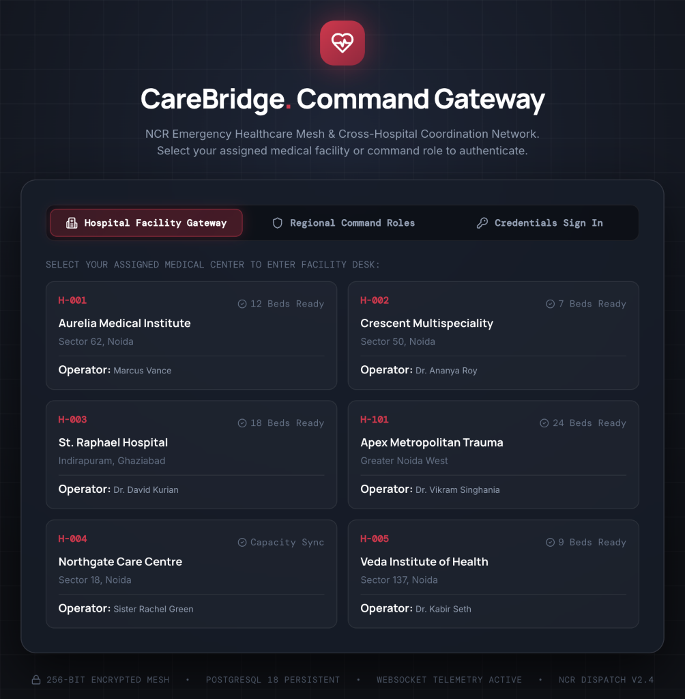
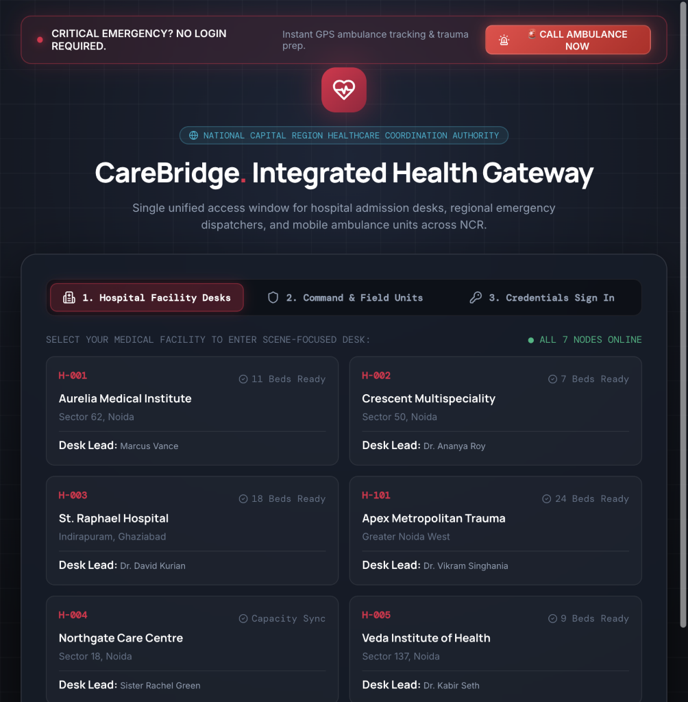
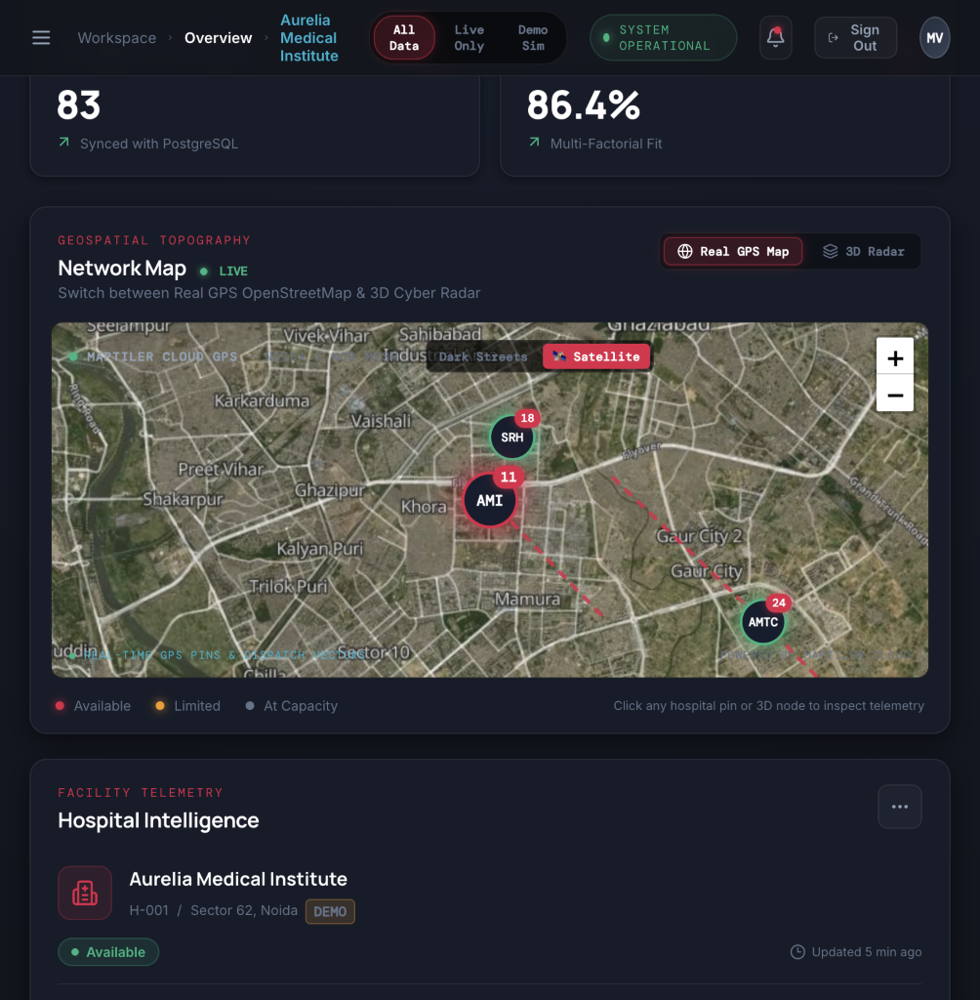

# CareBridge — Regional Healthcare Mission Control & Emergency Response System

CareBridge is a full-stack, real-time healthcare command center and emergency response coordination platform. Built for regional healthcare networks (NCR region), it coordinates emergency ambulance dispatches, ICU/bed readiness, inter-hospital patient transfers, and clinical audit compliance.



<p align="center">
  
  
</p>

---

## 🌟 Key Features

### 1. 🚨 Zero-Login Public SOS (Citizen Emergency Dispatch)
- **Zero Friction**: In critical emergencies, citizens do not need to register or sign in.
- **Live GPS Tracking**: Uses high-accuracy browser geolocation (`navigator.geolocation`) to pinpoint the caller's coordinates.
- **Instant Allocation**: Algorithmic engine scores nearby facilities based on specialty care (Cardiac, Trauma, Stroke, Respiratory) and real-time ICU readiness.
- **Live Vehicle Telemetry**: Dispatches an Advanced Life Support (ALS) ambulance unit with real-time ETA and direct emergency hotline access.

### 2. 🏛️ Unified Gateway (PM Vidyalaxmi-Style Multi-Portal)
- Eliminates cluttered, confusing "one-size-fits-all" dashboards.
- **Hospital Facility Desks**: 1-click tailored desk login for regional partner hospitals (Aurelia Medical Institute, Crescent Health, St. Raphael, Apex Trauma, Northgate Care, Veda Institute).
- **Command & Field Units**: Dedicated access for Regional Triage Coordinators, Paramedic EMTs, and Healthcare Compliance Auditors.
- **Credentials Sign In**: Secure email/password authentication backed by bcrypt hashing and JWT tokens.

### 3. 🏥 Tailored Hospital Facility Desks
- Hospital personnel see only their facility's vital metrics:
  - Available Ward Beds & Resuscitation ICU Beds
  - 1-Click Instant Capacity Adjuster
  - Real-time inbound ambulance telemetry and incoming transfers
  - Zero cognitive overload from regional dispatch noise

### 4. 🗺️ Dual Spatial Visualization (MapTiler Cloud + Three.js Radar)
- **MapTiler Cloud Vector GIS**: Real-world geographic tiles with dark streets and high-resolution satellite hybrid imagery.
- **Three.js 3D Cyber Radar**: Real-time rotating radar scan visualizing regional facility nodes and distance vectors.

### 5. 🛡️ Enterprise Security, RBAC & Immutable Audit Trail
- Multi-tier Role-Based Access Control (RBAC):
  - `coordinator`: Regional intake, triage evaluation, referral approval.
  - `hospital_staff`: Isolated to managing their own hospital's beds and inbound admissions.
  - `paramedic`: On-scene patient intake and transit updates.
  - `auditor`: Read-only access to tamper-evident audit logs.
- Immutable audit log records every action, actor, timestamp, IP address, and JSON state snapshot.

---

## 🏗️ Architecture & Tech Stack

```text
carebridge/
├── server/                        # Node.js & Express Full-Stack Backend
│   ├── index.js                   # REST API & WebSocket server entrypoint
│   ├── db.js                      # PostgreSQL 18 connection pool & auto-migrations
│   ├── auth.js                    # JWT token lifecycle & RBAC middleware
│   ├── matching.js                # Multi-factorial hospital matching algorithm
│   ├── websocket.js               # Native WebSocket broadcast engine
│   ├── audit.js                   # Tamper-evident immutable audit logger
│   └── routes/                    # Modular API route controllers
│       ├── auth.routes.js
│       ├── hospitals.routes.js
│       ├── requests.routes.js     # Includes unauthenticated /public-sos
│       ├── referrals.routes.js
│       ├── audit.routes.js
│       └── analytics.routes.js
├── src/                           # Modern React 18 Mission-Control Frontend
│   ├── main.jsx                   # Application orchestrator & Three.js 3D Radar
│   ├── LoginPortal.jsx            # PM Vidyalaxmi-style Gateway landing
│   ├── PublicSosModal.jsx         # Zero-login GPS SOS dispatch modal
│   ├── RealLeafletMap.jsx         # MapTiler Cloud Leaflet GIS component
│   ├── api.js                     # Unified API client & auto-reconnecting WS
│   └── styles.css                 # Dark mission-control theme & styling
├── test-e2e.mjs                   # Automated E2E verification test suite (17 tests)
└── vite.config.js                 # Vite dev proxy configuration
```

### Core Technologies
- **Frontend**: React 18, Vite 6, Three.js, Leaflet, Lucide Icons
- **Mapping**: MapTiler Cloud (`streets-v2-dark` & `hybrid` satellite)
- **Backend**: Node.js, Express, Native WebSockets (`ws`), JWT, Bcrypt
- **Database**: PostgreSQL 18 (relational schema with constraints & foreign keys)

---

## 🚀 Quick Start Guide

### Prerequisites
- Node.js 18+
- PostgreSQL 16+ running locally

### 1. Clone & Install
```bash
git clone git@github.com:satyamchaubey-gif/carebridge.git
cd carebridge
npm install
```

### 2. Configure Database & Environment
The backend defaults to connecting to PostgreSQL on `localhost:5433` (or `5432`):
```bash
# Optional: Set environment variables
export PGPORT=5433
export PGDATABASE=carebridge
export JWT_SECRET="your-secret-key"
```

### 3. Run Backend & Frontend Concurrently
```bash
# Terminal 1: Start Backend API (Port 4000)
npm run backend

# Terminal 2: Start Frontend (Port 5173)
npm run dev
```

Open [http://localhost:5173](http://localhost:5173) in your browser.

---

## 🧪 Automated Testing

CareBridge includes a comprehensive 17-point End-to-End automated test suite verifying all system capabilities:

```bash
node test-e2e.mjs
```

### Test Coverage Highlights
- ✅ PostgreSQL 18 schema verification and connection health
- ✅ JWT Authentication for all 4 roles (Coordinator, Hospital Staff, Paramedic, Auditor)
- ✅ RBAC boundary enforcement (Staff cross-facility isolation)
- ✅ Paramedic intake case creation
- ✅ Multi-factorial algorithmic hospital scoring & recommendation
- ✅ Cross-hospital referral lifecycle (Dispatched → Accepted → In Transit → Completed)
- ✅ Automatic bed deduction upon referral acceptance
- ✅ Zero-login citizen emergency SOS GPS dispatch
- ✅ Live WebSocket event broadcast delivery
- ✅ Tamper-evident immutable audit log persistence

---

## 📄 License
MIT License. Built for resilient emergency healthcare coordination.
